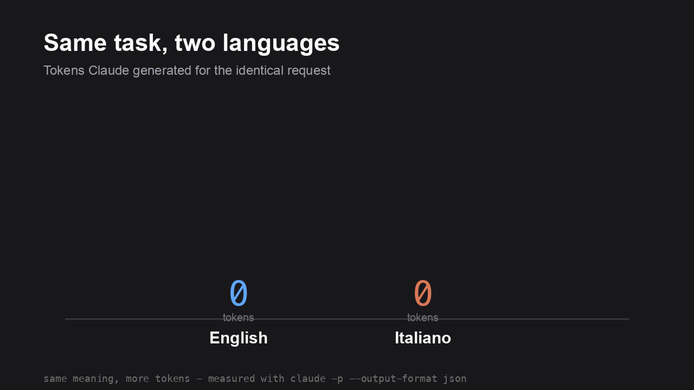

# Token cost: the same task in English vs Italian

A tiny, reproducible experiment behind a simple claim: **LLMs bill per token, and the
same meaning costs a different number of tokens per language — English is usually the
cheapest.** We ask Claude Code to do the *identical* task once in English and once in
Italian, and compare the tokens it generates.



## The task
Explain, in about six sentences, what each function in [`utils.py`](utils.py) does —
first in English, then in Italian. Same file, same instruction, only the language changes.

## Run it yourself

Requirements: [Claude Code](https://claude.com/claude-code) (`claude` on PATH and
authenticated) and [`jq`](https://jqlang.github.io/jq/). For the GIF: Python 3 + Pillow
(`pip install pillow`).

```bash
# macOS / Linux
./run.sh

# Windows (PowerShell)
.\run.ps1
```

Each run calls Claude headless and reads the real usage from its JSON output:

```bash
claude -p "Read utils.py and write a clear explanation, about 6 sentences,
           of what each function does. Respond in English." \
       --output-format json --max-turns 3
```

The script prints the output-token count for each language and the delta. To rebuild the
animation from your own run:

```bash
python3 make_gif.py    # reads en.json / it.json if present, else the sample numbers
```

## A sample result

| Language | Output tokens | Cost (USD) | Chars | chars/token |
| --- | --- | --- | --- | --- |
| English  | 387 | $0.0977 | 897  | 2.32 |
| Italiano | 640 | $0.1040 | 1360 | 2.13 |

**+65% more output tokens in Italian for the same request.** Two effects stack: Italian
tokenizes denser (fewer chars per token — the tokenizer effect) and the answer ran a bit
longer. We compare **output tokens** on purpose: they are Claude-measured and unaffected
by the large, shared, cached system-prompt overhead that is identical in both runs. Raw
JSON from the sample run is in `sample-en-result.json` / `sample-it-result.json`.

`claude -p` is non-deterministic, so your numbers will land in the same ballpark, not
exactly here. Run each side a few times if you want a steadier figure.

## License
MIT
